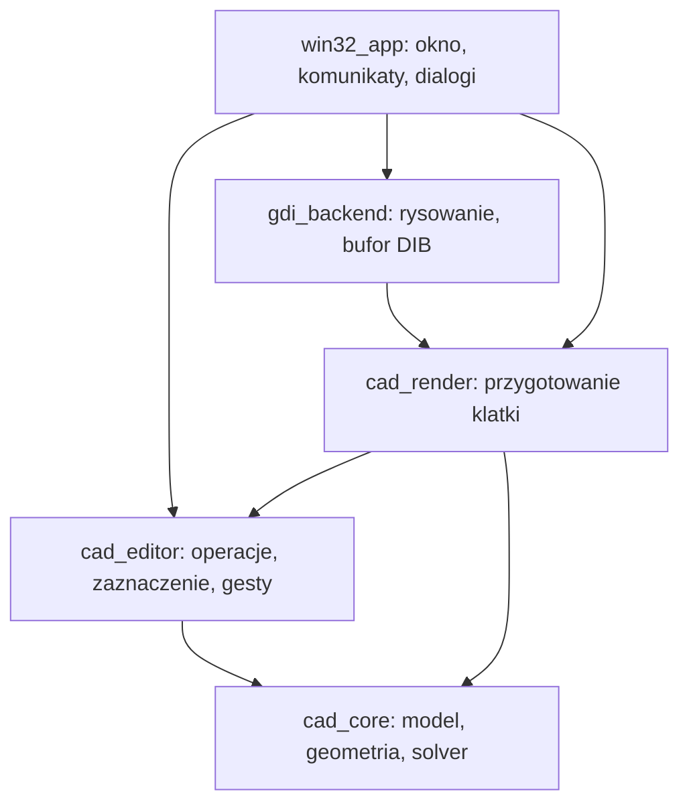

# Warstwy i zależności

[Spis treści](README.md)

## Proponowany podział



Strzałka oznacza zależność kodu. `cad_core` nie zależy od żadnej pozostałej warstwy. `cad_editor` nie zależy od renderera. `cad_render` odczytuje niemodyfikowalny widok stanu edytora.

| Moduł | Odpowiedzialność | Czego nie powinien znać |
| --- | --- | --- |
| `cad_core` | Model dokumentu, topologia, geometria, relacje, solver, scena demonstracyjna | Windows, GDI, mysz, menu, piksele ekranu |
| `cad_editor` | Polecenia edycji, zaznaczenie, przeciąganie, hit testing, kamera, podgląd zmian | `HWND`, `HDC`, komunikaty `WM_*` |
| `cad_render` | Zamiana widoku sceny na prymitywy, Bresenham, oznaczenia i style | Uchwyty Windows i modyfikowanie dokumentu |
| `gdi_backend` | Wykonanie poleceń rysowania, zasoby GDI, bufor obrazu | Solver, reguły ciągłości, zmiany topologii |
| `win32_app` | Uruchomienie, okna, menu, kontrolki, dialogi, integracja modułów | Własne implementacje relacji geometrycznych |

## Granice API

Obecna implementacja sesji jest w [`src/editor`](../../src/editor/README.md). Przyjmuje pozycje i tolerancję w jednostkach świata, obsługuje zaznaczenie, gesty, Esc i dwa polecenia topologii. Jest kompilowana w aplikacji i testach bez zależności od Windows; osobna biblioteka `cad_editor` oraz opisane niżej `PointerEvent`, `EditCommand` i `EditorView` pozostają docelowymi rozszerzeniami.

Rdzeń udostępnia dane geometryczne i wyniki operacji, np. `Document`, `Vec2`, `EdgeId`, `SolveResult`. Nie przyjmuje `POINT`, `RECT`, `COLORREF` ani struktur komunikatów systemowych. Nagłówka `framework.h` używamy wyłącznie w kodzie Windows.

Edytor udostępnia mały zestaw operacji:

```cpp
class EditorSession {
public:
    void pointerDown(const PointerEvent& event);
    void pointerMove(const PointerEvent& event);
    void pointerUp(const PointerEvent& event);
    void cancelInteraction();
    EditResult execute(const EditCommand& command);
    EditorView view() const;
};
```

To szkic kontraktu, a nie gotowa deklaracja do skopiowania. `PointerEvent` zawiera pozycję w obszarze widoku, przycisk i modyfikatory. `EditCommand` jest zamkniętym zestawem operacji, np. `std::variant`; nie wymaga klasy bazowej dla każdego polecenia. `EditorView` zawiera tylko dane do odczytu, ważne do następnej mutacji sesji.

Wynik operacji zawiera status, identyfikatory problematycznych relacji i kod diagnostyczny. Teksty interfejsu są dobierane poza rdzeniem. Nie zakładamy, że diagnostyka solvera wyznaczy najmniejszy możliwy zbiór sprzecznych relacji.

## Podłączenie innego frontendu

Frontend Qt, SDL lub inny program natywny:

1. Tworzy `EditorSession` i przekazuje neutralne zdarzenia oraz polecenia.
2. Odczytuje `EditorView`.
3. Używa `cad_render` i własnego backendu albo sam rysuje odczytaną geometrię.
4. Pokazuje błędy i dialogi w swoim zestawie kontrolek.

Podmiana frontendu wymaga adaptera wejścia i rysowania, ale nie zmienia modelu, solvera ani zasad edycji. Port do przeglądarki wymaga dodatkowo kompilacji np. do WebAssembly i warstwy integracji; nie jest automatyczną konsekwencją tego podziału.

## Własność i czas życia

`AppState` posiada `EditorSession`, backend GDI i ustawienia okna. Sesja posiada dokument, stan interakcji i transakcję bieżącej edycji. Dokument posiada wszystkie encje i relacje. Odwołania między encjami używają identyfikatorów, nie wskaźników.

Na początek wszystko działa w jednym wątku. Obliczenia nie odbywają się w `WM_PAINT`: malowanie odczytuje gotowy stan. Nie wprowadzamy kontenera DI, magistrali zdarzeń ani wielowątkowego harmonogramu.
