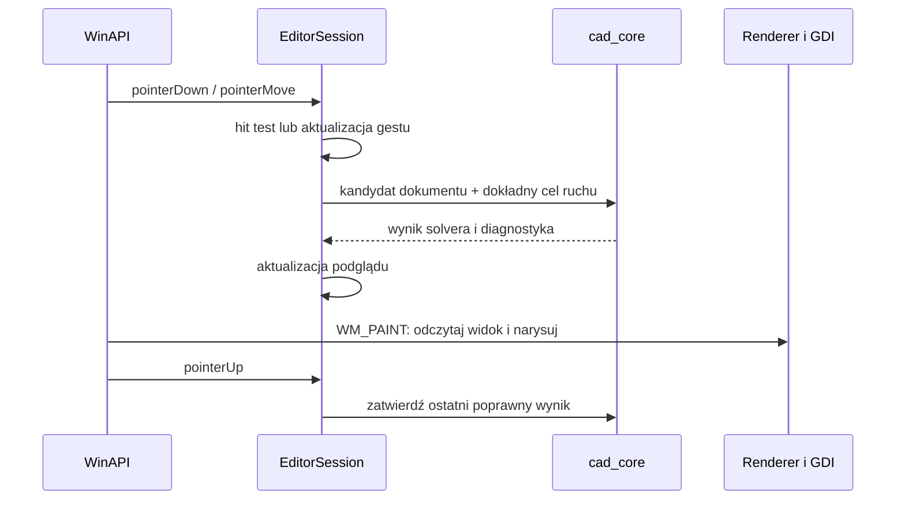

# Edycja i obsługa wejścia

[Spis treści](README.md)

## Sesja edytora

`EditorSession` łączy dokument i jego operacje z neutralnym stanem interakcji:

- `Selection`: wskazane wierzchołki, uchwyty, krawędzie, wielokąty lub ograniczenia.
- `InteractionState`: `Idle`, `DraggingVertex`, `DraggingControlPoint`, `DraggingPolygon`.
- `DragTransaction`: stan początkowy, punkt zaczepienia, ostatni poprawny wynik i bieżący podgląd.
- `Viewport`: transformacja świata na widok i odwrotna.
- `EditorSettings`: m.in. biblioteczne rysowanie odcinków lub Bresenham oraz widoczność uchwytów.

Stan interakcji można wyrazić przez `std::variant`. Nie rozdzielamy go na zestaw niezależnych flag, które pozwalałyby przypadkowo uruchomić dwa gesty jednocześnie.

## Polecenia

Planowany zestaw: `SplitEdge`, `DeleteVertex`, `SetEdgeType`, `SetContinuity`, `AddFixedLength`, `AddParallel`, `RemoveConstraint`, `ResetDemoScene` oraz operacje zaznaczania. Polecenia odnoszą się do ID, a nie kontrolek czy pozycji w menu.

WinAPI pobiera wartość z dialogu długości i przekazuje gotową liczbę. Rdzeń niezależnie sprawdza, czy jest skończona i dodatnia oraz czy wskazana krawędź jest odcinkiem. Domyślna wartość dialogu to bieżąca długość wskazanego odcinka. Dla Béziera i łuku polecenie zadania długości jest niedostępne.

Zaznaczenie dwóch krawędzi będących odcinkami umożliwia dodanie równoległości; mogą pochodzić z różnych wielokątów. Jeśli choć jedna jest Bézierem lub łukiem, polecenie jest niedostępne, a próba wywołania go przez API kończy się błędem walidacji. Po zmianie topologii sesja usuwa z zaznaczenia ID, które już nie istnieją.

Konwersja odcinka na krzywą usuwa dotyczące go relacje długości i równoległości. Opis polecenia w UI informuje o tym skutku; po udanej operacji sesja odświeża listę relacji oraz zaznaczenie ich oznaczeń. Nie dodajemy osobnego dialogu potwierdzenia.

## Przepływ przeciągania

Przy chwyceniu wierzchołka lub uchwytu zapamiętujemy różnicę między kursorem a jego środkiem, aby uniknąć skoku przy trafieniu w pobliże punktu. Dalej punkt porusza się dokładnie o ruch kursora. Przy przesuwaniu całego wielokąta translację liczymy względem miejsca rozpoczęcia gestu.

`WM_LBUTTONDOWN` rozpoczyna gest i przechwycenie myszy przez `SetCapture`. `WM_LBUTTONUP` kończy gest i wywołuje `ReleaseCapture`. `WM_CAPTURECHANGED`, utrata aktywności lub `Esc` anulują niedokończony gest. Adapter nie uruchamia solvera po raz drugi podczas `WM_PAINT`.

## Hit testing

Priorytet trafień: uchwyt Béziera, wierzchołek, oznaczenie relacji, krawędź, wnętrze wielokąta. Widoczne punkty mają obszar trafienia określony w pikselach logicznych, przeliczany zgodnie z DPI i skalą widoku.

Odległość od krzywej wyznaczamy na łamanej powstałej ze wspólnego samplera. Na początek wystarczy przegląd liniowy elementów sceny. Nie wprowadzamy drzewa przestrzennego bez potrzeby.

Wnętrze samoprzecinającego się wielokąta definiujemy regułą parzystości przecięć. W obszarach nakładania wybieramy obiekt rysowany na wierzchu; zaznaczenie krawędzi daje alternatywną drogę wskazania wielokąta. Test wnętrza obejmuje próbkowane krzywe, nie tylko cięciwy.

## Proponowana obsługa

| Akcja | Zachowanie |
| --- | --- |
| LPM na punkcie lub uchwycie + ruch | Przeciąganie wskazanego elementu |
| LPM we wnętrzu wielokąta + ruch | Przesunięcie całego wielokąta |
| LPM na krawędzi | Zaznaczenie krawędzi |
| Ctrl + LPM na krawędzi | Dodanie/usunięcie krawędzi w zaznaczeniu, m.in. do pary relacji |
| PPM | Menu kontekstowe operacji dopuszczalnych dla wskazanego elementu |
| Delete | Usunięcie zaznaczonego wierzchołka albo relacji; bez kasowania całych wielokątów |
| Esc | Anulowanie gestu; poza gestem wyczyszczenie zaznaczenia |
| F1 | Dokumentacja i skróty |

Radio buttony wybierają algorytm odcinków. Menu lub prosty panel umożliwia zmianę typu krawędzi, ciągłości i zarządzanie relacjami. Nie budujemy rozbudowanego panelu właściwości przed ukończeniem geometrii.

Tworzenie nowych wielokątów w UI i pełne undo/redo są poza pierwszym zakresem: zadanie dopuszcza scenę zdefiniowaną kodem. Transakcje mają umożliwić późniejsze dodanie historii bez zmiany zasad działania rdzenia.
